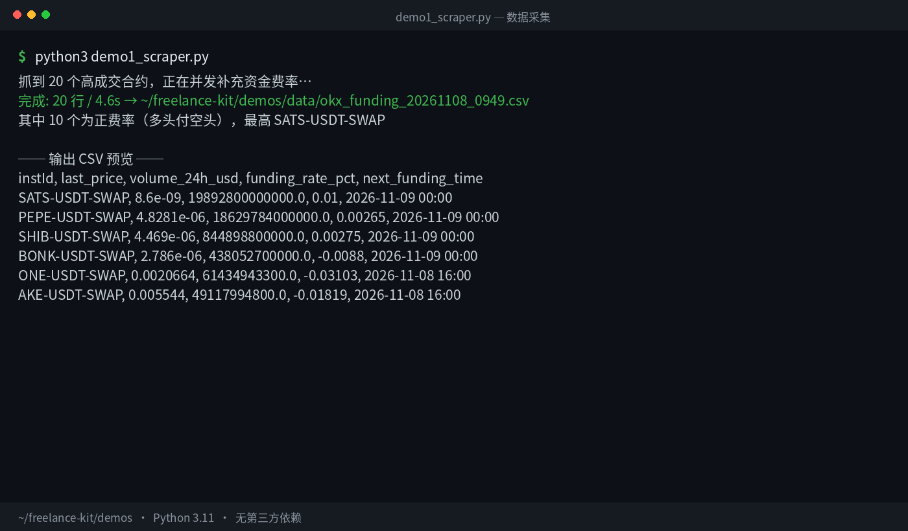
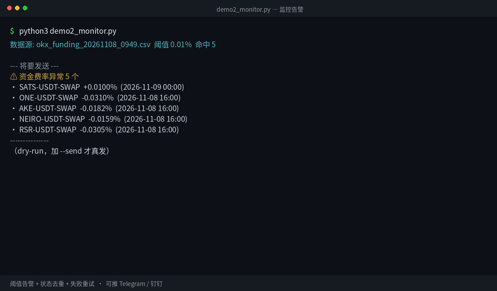
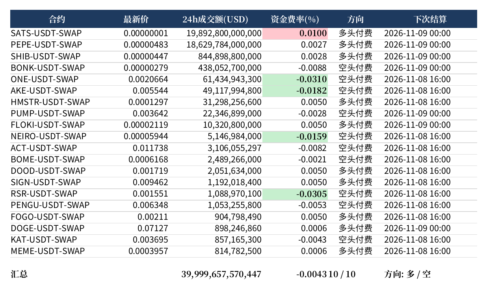

# Automation Portfolio — Python data pipelines, scrapers & bots

Runnable demos of the kind of work I take on: **turn repetitive manual work into a
script that runs itself**. Every demo here executes against real public APIs — no mock
data, no screenshots of code that doesn't run.

> Available for freelance work: scrapers, monitoring bots, report automation,
> Apify actors, Telegram bots.
> Contact: zhangwenxing@163.com

---

## 1. Scraper → clean CSV



Pulls 24h tickers from a public exchange API, fans out concurrent requests to enrich
each symbol with its funding rate, normalizes the output and writes a timestamped CSV.

- Concurrency via `ThreadPoolExecutor`, automatic retry, no third-party dependencies
- Symbol normalization is the hard part: `BTC-USDT-SWAP`, `XBTUSDTM`, `BTC_USDT` → `BTC`
- 20 symbols in ~4.6 s; scales linearly with workers

```bash
python3 demos/demo1_scraper.py
```

## 2. Monitoring + alerting bot



Watches a data source on a schedule, applies thresholds, renders a compact alert and
pushes it to Telegram — **only when something actually changed**.

- Deduplication by content key, so the same event never alerts twice
- State is committed **only after a successful send** — a failed push retries next cycle
- Silent when there's nothing new (no heartbeat noise)

```bash
python3 demos/demo2_monitor.py           # dry-run: print what would be sent
TG_BOT_TOKEN=... TG_CHAT_ID=... python3 demos/demo2_monitor.py --send
```

## 3. Excel report automation



Replaces the manual export-copy-format cycle: reads the data, applies formatting rules,
highlights anomalies, adds a totals row and writes a dated `.xlsx` ready to send.

- Header styling, freeze panes, autofilter, number formats
- Conditional highlighting on the rate cell (red = longs pay, green = shorts pay)
- Landscape fit-to-width page setup so PDF export never truncates columns

```bash
pip install openpyxl
python3 demos/demo3_report.py
```

---

## Apify Actors

Three actors ready to publish to the [Apify Store](https://apify.com/store), each with
input schema, Dockerfile and local-runnable logic:

| Actor | What it does | Data source |
|---|---|---|
| [`funding-arb`](apify-actors/funding-arb) | Cross-exchange funding-rate spreads ranked by APR (8 exchanges) | OKX, Gate, MEXC, HTX, KuCoin, Bitget, Binance, Bybit public APIs |
| [`defi-yield`](apify-actors/defi-yield) | Stablecoin yields filtered by TVL / APY / chain / IL risk | DefiLlama pools API |
| [`polymarket-lp`](apify-actors/polymarket-lp) | Prediction-market liquidity rewards sorted by USD/day | Polymarket gamma API |

Each has `src/logic.py` that runs standalone (`python3 src/logic.py`), so you can verify
the data source without an Apify account.

---

## Freelance kit

- [`docs/portfolio.zh.md`](docs/portfolio.zh.md) — 5 project write-ups (中文)
- [`docs/pricing.zh.md`](docs/pricing.zh.md) — rate card (中文)
- [`bids/`](bids) — proposal templates for Fiverr / Upwork / 程序员客栈

---

## 中文说明

这个仓库是我的自动化接单作品集，三块内容：

1. **`demos/`** — 三个可直接运行的演示：数据采集 → CSV、定时监控 → 告警、自动生成 Excel 报表
2. **`apify-actors/`** — 三个可上架 Apify Store 的 Actor（资金费率套利、DeFi 收益、Polymarket 做市奖励）
3. **`bids/` + `docs/`** — 投标模板、报价表、作品说明

所有数据源都是公开 API，运行不需要任何密钥：

```bash
python3 demos/demo1_scraper.py
python3 demos/demo2_monitor.py
pip install openpyxl && python3 demos/demo3_report.py
python3 apify-actors/funding-arb/src/logic.py
```

接单方向：数据采集、监控告警机器人、报表自动化、Telegram 机器人、Apify Actor 开发。
联系方式：zhangwenxing@163.com

## License

MIT — see [LICENSE](LICENSE).
